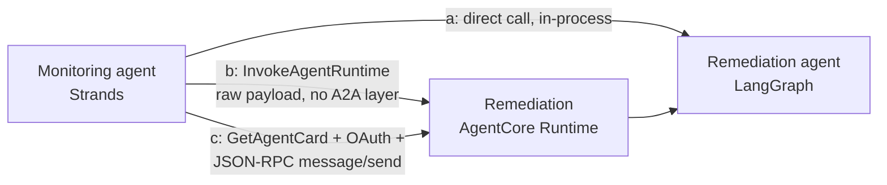

# Two frameworks, two agents, three ways to wire them together

A runnable demo of what the A2A (Agent-to-Agent) protocol actually costs you on Amazon
Bedrock AgentCore, versus the two cheaper alternatives, for a real cross-framework
incident-response pair: a Strands monitoring agent and a LangGraph remediation agent,
each deployed as its own AgentCore Runtime A2A server behind Cognito OAuth.

Built from the real implementation in AWS's own sample,
[`sample-fully-autonomous-incident-response`](https://github.com/aws-samples/sample-fully-autonomous-incident-response)
(`A2A-Multi-Agents-AgentCore-main/multi-agents/`), with three deliberate deviations: two
frameworks instead of three (no Google ADK host orchestrator), LangGraph instead of the
OpenAI Agents SDK for the remediation agent (reusing the framework from the earlier
rajmurugan.com LangGraph-vs-AgentCore post instead of a new OpenAI API key), and a local
static runbook knowledge source instead of JIRA ticketing or Tavily web search. No new
paid third-party API signups.

## Status: code built, NOT YET deployed or measured

This repo was scaffolded in one session on 2026-10-20: the CDK stack, both agents, the
measurement harness, and this README's structure are written and committed. `make deploy`
was not run -- the AWS SSO session for the target account had expired mid-session, and
refreshing it needs an interactive browser login (SSO portal + MFA) that could not be
completed headlessly. Nothing below the line is deployed, so the "what it shows" numbers
further down do not exist yet; `docs/transcript.txt` says so explicitly rather than
being filled with invented figures.

To finish this the moment SSO is refreshed:

    aws sso login --profile personal
    make deploy   # ~5-10 minutes: Cognito, two ECR images, two AgentCore Runtimes
    make demo     # runs the three comms patterns, writes docs/transcript.txt
    make destroy  # tears everything down

Everything past this point describes what the code is built to do, not a result that
has been observed yet.

## The idea in one diagram

## What it's built to show

| # | Pattern | What it measures |
|---|---------|-------------------|
| a | Direct call | One process, both agents' functions, no AgentCore hop at all |
| b | AgentCore-native invoke | `InvokeAgentRuntime` with a raw JSON payload -- bypasses agent-card discovery and the A2A JSON-RPC envelope |
| c | Full A2A protocol | `GetAgentCard` discovery, a Cognito client-credentials token, then a JSON-RPC 2.0 `message/send` through the same `InvokeAgentRuntime` call |

**A genuine finding from building this, not from running it yet:** the task behind this
repo asked whether AgentCore has a cross-runtime invoke primitive distinct from A2A. It
does -- `InvokeAgentRuntime` -- but it is not a different HTTP endpoint or transport from
the "full A2A" path. Both (b) and (c) go through the identical data-plane operation
against the identical Runtime ARN (confirmed against the real `bedrock-agentcore`
botocore service model: `POST /runtimes/{agentRuntimeArn}/invocations`). AgentCore does
not expose a bare HTTPS URL you can `curl` once a custom JWT authorizer is attached; the
"protocol" is entirely in what you put in the payload (a raw JSON object vs. a JSON-RPC
2.0 envelope) and whether you call the separate `GetAgentCard` operation first. That
collapses the expected three-tier latency story into two tiers of transport with a
payload-shape difference between them -- worth confirming with real numbers once this
deploys, not assuming from the architecture diagram alone.

## A sharp edge I hit

Not from AgentCore itself -- from the environment this was built in. The local AWS SSO
session for the target profile expired mid-build, and refreshing `aws sso login`
requires completing a real browser-based login (IdP + MFA) that cannot be driven
headlessly by an automated session. Every step downstream of `cdk deploy` -- the two
AgentCore Runtimes, the Cognito OAuth flow, the actual measured numbers -- is blocked on
that single interactive step. The fix isn't code; it's running `aws sso login --profile
personal` as a human, once, before `make deploy`. Documented here because it is exactly
the kind of gotcha the other two repos in this series warn about in their own "sharp
edge" sections, just one level below the application layer: a credential, not a Cedar
policy or an interceptor, was the thing that actually stopped the build.

## How it works

- `cdk/` -- CDK (TypeScript) stack: one Cognito user pool with a resource server and two
  client-credentials app clients (one per agent, each scoped only to invoke the *other*
  agent, never itself), two container images built and pushed as CDK assets
  (`DockerImageAsset`, `linux/arm64` -- AgentCore Runtime's required architecture), and
  two `AWS::BedrockAgentCore::Runtime` resources in `ProtocolConfiguration: A2A` mode,
  each behind the shared Cognito discovery URL as a custom JWT authorizer.
- `agents/monitoring_agent/` -- Strands SDK agent with local CloudWatch tools (alarms,
  metrics, log filtering), wrapped by `strands.multiagent.a2a.server.A2AServer` --
  reusing the real pattern from the AWS sample's `monitoring_agent.py`, minus the
  Gateway/Memory/Identity primitives (out of scope here; see below).
  `find_incidents_direct()` is the same logic exposed bare, for comms pattern (a).
- `agents/remediation_agent/` -- LangGraph graph (classify finding -> match a local
  `runbooks.json` entry -> ask the model for a grounded recommendation), wrapped directly
  with the `a2a-sdk`'s `AgentExecutor` / `A2AStarletteApplication` primitives, since
  LangGraph has no built-in A2A server the way Strands does. `remediate_direct()` is the
  same graph exposed bare, for comms pattern (a).
- `demo/demo.py` -- runs all three comms patterns `RUNS_PER_PATTERN` times each against
  the real deployed stack, prints min/median/max latency per pattern, and prints the cost
  formula (measured call counts x published list-price rates) rather than a precomputed
  number -- see Cost below.

## Not in scope

AgentCore Gateway, Memory, Identity (beyond the workload-access-token calls Runtime
makes for you) and Observability primitives from the AWS sample -- this repo only
exercises Runtime + the A2A protocol layer, by design (see the task scope this was built
against). Not a production reference architecture: no VPC isolation, no WAF in front of
the Cognito domain, no secret rotation. Not the AWS sample 1:1 -- no Google ADK host
agent, no JIRA, no Tavily. The `a2a-sdk` wiring in `remediation_agent/agent.py` follows
the library's documented `AgentExecutor` contract but has not been exercised against a
live AgentCore Runtime yet (see Status) -- treat it as a best-effort implementation
pending the first real `make deploy`.

## Cost

**Measured:** nothing yet -- see Status. Once `make demo` has run, `docs/transcript.txt`
will carry the real call counts and latencies this section currently lacks.

**List prices** (cross-checked 2026-10-20, not AWS-account-specific):

- AgentCore Runtime compute: $0.0895/vCPU-hour + $0.00945/GB-hour (v1 tier), billed per
  second with a 1-second minimum and a 128MB memory minimum
  ([pricing](https://aws.amazon.com/bedrock/agentcore/pricing/)).
- AgentCore Identity: $0.010 per 1,000 token/API-key requests for non-AWS resources; no
  additional charge when used through Runtime, which is the case here.
- Claude 3.5 Haiku on Bedrock, us-east-1, on-demand: $0.80 per 1M input tokens / $4.00 per
  1M output tokens (cross-checked across aggregators against AWS's published on-demand
  rate; verify directly on the [Bedrock pricing page](https://aws.amazon.com/bedrock/pricing/)
  before relying on it for a budget).
- Cognito: free tier covers this demo's token volume; not priced further here.

This is an estimate from list prices, not a measured bill, until `make demo` runs.

## Run it

Needs an AWS account with CDK bootstrapped in us-east-1, Node 22+, Python 3.12+, Docker
(for the `linux/arm64` image builds), and `AWS_PROFILE` set to an identity with
permission to create Cognito, IAM, ECR and `AWS::BedrockAgentCore::*` resources.

    make deploy    # Cognito, two ECR images (CDK assets), two AgentCore Runtimes, IAM
    make demo      # runs the three comms patterns, writes docs/transcript.txt
    make destroy   # removes everything

The Cognito client secret never appears in `cdk/cdk.outputs.json`; `make demo` fetches it
live via `DescribeUserPoolClient` so it isn't sitting in a plaintext stack-outputs file.
