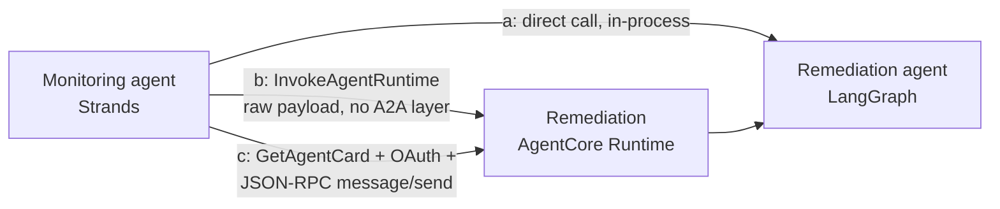

# Two frameworks, two agents, three ways to wire them together

A runnable demo of what the A2A (Agent-to-Agent) protocol actually costs you on Amazon
Bedrock AgentCore, versus the two cheaper alternatives, for a real cross-framework
incident-response pair: a Strands monitoring agent and a LangGraph remediation agent,
each deployed as its own AgentCore Runtime A2A server behind Cognito OAuth.

Built from the real implementation in AWS's own sample,
[`sample-fully-autonomous-incident-response`](https://github.com/aws-samples/sample-fully-autonomous-incident-response)
(`A2A-Multi-Agents-AgentCore-main/multi-agents/`), with three deliberate deviations: two
frameworks instead of three (no Google ADK host orchestrator), LangGraph instead of the
OpenAI Agents SDK for the remediation agent (reusing the framework from the earlier
rajmurugan.com LangGraph-vs-AgentCore post instead of a new OpenAI API key), and a local
static runbook knowledge source instead of JIRA ticketing or Tavily web search. No new
paid third-party API signups.

## Status: Tier 2 shipped -- human-approved, Cedar-policy-enforced reversible remediation (2026-10-22)

Approved by Raj same-day ("go tier 2") right after Tier 1's fix was independently
verified. The pitch: two frameworks detect and propose; a human approves; policy
enforces -- deliberately short of full autonomy. The remediation agent now proposes a
structured action (`propose_remediation_action()` in `agents/remediation_agent/agent.py`,
driven by a new `proposed_action` field on `runbooks.json`'s `error_rate` entry) but holds
no credential able to execute one; execution only happens through a new AgentCore Gateway
with a Cedar policy (ENFORCE mode) scoped to one real, tagged test SSM parameter
(`/a2a-incident-demo/feature-flags/checkout-api-test-maintenance-mode`), behind a logged
human approval. All four required acceptance criteria passed live on the first full
`make tier2-demo` run: a logged approval with a real IAM approver identity and timestamp, a
no-approval attempt denied by Cedar (not a prompt), an untagged-resource attempt denied by
Cedar, and a rollback that was independently re-verified via a direct `ssm:GetParameter`
call, not just trusted from the Lambda's own return value. Full transcript:
`docs/tier2_transcript.txt`; approval log: `docs/tier2_approval_log.jsonl`; full reasoning
and evidence: `docs/specs/agentcore-a2a-incident-response.md`'s Tier 2 section. See "Sharp
edges I hit (2026-10-22, Tier 2)" below for what building Gateway + Policy for the first
time in this repo (the sibling `agentcore-acts-as-the-user` repo had already built the same
primitives once) actually took.

## Status: the incident is real now -- fixed, deployed, measured, torn down (2026-10-22)

The 2026-10-21 build measured A2A transport mechanics for real but faked the "incident"
in "incident response": a hardcoded string was fed to both agents, and the hand-off was
scripted by the demo harness rather than done agent-to-agent. An evidence review caught
this before the blog post was rewritten (see `docs/specs/agentcore-a2a-incident-response.md`
for the full reasoning) and this session fixed it for real, against a live redeploy:

- `make incident` creates a real, tagged CloudWatch metric + alarm and drives it into
  `ALARM` for real (not a hardcoded string).
- The monitoring agent's own CloudWatch tools detect it for real -- 5/5 runs, 100%,
  checked against `describe-alarms`/`get-metric-statistics` each time, never retried on a
  miss.
- The monitoring agent itself -- not the demo harness -- fetches the remediation agent's
  card and sends `message/send` with its own OAuth token, obtained through AgentCore
  Identity's outbound-auth credential provider (no Cognito client secret in its code, env,
  or image).

All 20 measured runs (5 each: direct-call baseline, native-invoke baseline, a TEST_FINDING
control run for like-for-like comparison with 2026-10-21, and the real detect+hand-off
path) are in `docs/transcript.txt`. The stack was torn down afterwards and independently
verified gone -- see "Teardown". See "Sharp edges I hit (2026-10-22)" below for what this
took: outbound auth worked, but needed five IAM iterations against five different live
AccessDeniedException messages, plus two unrelated real bugs this session's new A2A path
was the first thing to ever surface.

The 2026-10-21 deploy's own history is kept below for the transport-measurement findings,
which are still valid and unchanged.

## The idea in one diagram

## What it's built to show

| # | Pattern | What it measures | Hand-off driven by |
|---|---------|-------------------|---------------------|
| a | Direct call | One process, both agents' functions, no AgentCore hop at all | `demo.py` (TEST_FINDING) |
| b | AgentCore-native invoke | `InvokeAgentRuntime` with a raw JSON payload -- bypasses agent-card discovery and the A2A JSON-RPC envelope | `demo.py` (TEST_FINDING) |
| c (control) | Full A2A protocol, TEST_FINDING | Like-for-like comparison with the 2026-10-21 numbers | `demo.py` fetches remediation's card and sends `message/send` itself (the OLD, pre-fix method) |
| c (real) | Full A2A protocol, real incident | The actual agent-to-agent hand-off | the MONITORING AGENT ITSELF fetches remediation's card and sends `message/send` with its own OAuth token -- `demo.py` only triggers the run by messaging the monitoring runtime |

Patterns (a) and (b) are unchanged transport baselines -- they exist to measure raw
transport cost, not hand-off realism, so they still use the scripted `TEST_FINDING`
string on purpose (see `docs/specs/agentcore-a2a-incident-response.md`).

**A genuine finding, confirmed against the live deploy, not just the botocore model:** the
task behind this repo asked whether AgentCore has a cross-runtime invoke primitive
distinct from A2A. It does -- `InvokeAgentRuntime` -- but it is not a different HTTP
endpoint or transport from the "full A2A" path. Both (b) and (c) go through the identical
data-plane operation against the identical Runtime ARN
(`POST /runtimes/{agentRuntimeArn}/invocations`), and AgentCore genuinely does expose that
as a bare HTTPS endpoint you can `curl` -- confirmed by calling it directly with
`urllib` during this build. The real wrinkle, only visible once a custom JWT authorizer
is actually attached and invoked: **boto3 cannot call it at all.** AWS's own devguide
says so outright ("If you plan on integrating your agent with OAuth, you can't use the
AWS SDK to call InvokeAgentRuntime. Instead, make an HTTPS request") and the first attempt
with boto3 confirmed it. A Runtime supports IAM SigV4 *or* JWT inbound auth, never both,
so once `CustomJwtAuthorizer` is configured -- which it is on both runtimes here, since
testing the A2A protocol requires it -- **every** invocation, not just the "full A2A" one,
needs a raw HTTPS call with an `Authorization: Bearer` header. That collapses the expected
three-tier story even further than the architecture alone suggested: (b) and (c) are the
same transport, the same auth mechanism, and the same payload envelope requirement, once
you account for what the deployed container will actually accept (see below) -- the only
real difference left is whether you fetch the agent card first.

A second finding, only visible by actually sending pattern (b)'s "raw, non-A2A payload" to
a live A2A-protocol runtime: it doesn't reach a different code path in the container, it
reaches the *same* container, and that container -- built as a pure A2A JSON-RPC server,
per AWS's own guidance for how to structure one -- has no other route to send it to. The
raw payload gets a same-shaped JSON-RPC validation error back (not an AgentCore-level
rejection), because AgentCore really is "a transparent proxy layer" all the way down to
payload validation, exactly as its own devguide claims. "Bypassing the A2A envelope" only
bypasses agent-card discovery; it doesn't let you dodge the envelope the container itself
requires.

## Sharp edges I hit

A prior session hit the AWS-SSO-session-expired blocker that used to be documented here;
this session had a fresh login and got all the way to a real deploy, which surfaced sharp
edges that are far more specific to AgentCore itself. In the order they had to be fixed
to get `cdk deploy` past `CREATE_FAILED`:

1. **`NetworkConfiguration` is required, and the first deploy attempt didn't set it.**
   Correction (2026-10-21): the original wording here blamed the CDK L1 construct's
   TypeScript type for marking this field optional. That's wrong -- checked directly
   against `aws-cdk-lib@2.250.0`'s generated types, `CfnRuntimeProps.networkConfiguration`
   has no `?`; it's non-optional in the interface itself, matching the underlying
   CloudFormation resource. This was a plain miss on the first pass, not a typing gap.
   The service rejects a runtime with none at deploy time ("Invalid request provided:
   NetworkConfiguration is required"); the fix was adding `networkConfiguration: {
   networkMode: 'PUBLIC' }` on both runtimes.
2. **A circular-looking IAM policy, caused by cross-referencing the other Runtime's ARN,
   was actually a dependency-ordering RACE, not a circular dependency.** The cross-runtime
   `InvokeAgentRuntime` grant was originally added via `role.addToPolicy()`, which CDK
   merges into the role's single auto-generated `DefaultPolicy` resource alongside the
   baseline ecr/logs/bedrock permissions the Runtime needs just to be *created*. Because
   that merged policy also referenced the other Runtime's `attrAgentRuntimeArn`,
   CloudFormation created the Policy and the Runtime in parallel (both only depend on the
   Role) -- and the Runtime's own synchronous ECR-access check at creation time routinely
   won that race, failing with "Access denied ... ecr:GetAuthorizationToken" against IAM
   policies that were completely correct, just not attached yet. Fixed by splitting the
   cross-invoke grant into its own `iam.Policy` construct and adding an explicit
   `runtime.node.addDependency(role's DefaultPolicy)` so CloudFormation sequences policy
   attachment before Runtime creation, every time.
3. **`ecr:GetAuthorizationToken` has no resource ARN of its own and isn't covered by
   `repository.grantPull()`** -- that grant only covers the repo-scoped
   `BatchGetImage`/`GetDownloadUrlForLayer`/`BatchCheckLayerAvailability` actions. Needed a
   separate `resources: ['*']` statement for it.
4. **A2A containers must listen on port 9000 at the root path, not port 8080 at
   `/invocations`.** 8080/`/invocations` is the plain-HTTP/MCP protocol convention; AgentCore's
   A2A `ProtocolConfiguration` proxies the container on 9000 at `/` instead, per its own
   devguide. The repo's two Dockerfiles and both agents' `agent.py` originally defaulted to
   8080 (copied from the plain-HTTP convention, not re-checked against the A2A-specific
   docs) -- the runtimes came up `READY` with the wrong port and were simply unreachable.
5. **`boto3` cannot invoke an AgentCore Runtime once a `CustomJwtAuthorizer` is attached** --
   see the finding above. `demo/demo.py`'s original (b)/(c) implementations used
   `boto3.client('bedrock-agentcore').invoke_agent_runtime()`/`get_agent_card()`; both
   needed rewriting to raw `urllib` HTTPS calls with a `Bearer` token.
6. **Cognito's OAuth2 token endpoint lives on the hosted-UI domain, not the issuer URL
   the discovery document advertises.** `demo.py` originally derived the token endpoint by
   string-stripping `/.well-known/openid-configuration` off `DiscoveryUrl` -- that produces
   `https://cognito-idp.<region>.amazonaws.com/<pool-id>`, which doesn't serve
   `/oauth2/token`. Fixed by adding an explicit `CognitoDomainUrl` CDK output from the
   domain construct's own `baseUrl()`.
7. **Claude 3.5 Haiku has reached end-of-life on Bedrock.** The first real model-invoking
   demo run returned `ResourceNotFoundException: This model version has reached the end of
   its life` -- not a hypothetical staleness risk, an actual dead model ID in the code as
   written. Replaced with Haiku 4.5 (`us.anthropic.claude-haiku-4-5-20251001-v1:0`,
   confirmed GA/Active against its AWS model card), which in turn needed an IAM fix: its
   `us-east-1` access is a cross-Region **inference profile**, a different resource type
   from the `foundation-model/*` ARN the original IAM policy granted, so the first
   corrected run still failed with `AccessDeniedException` on
   `bedrock:InvokeModel` until `arn:aws:bedrock:*:*:inference-profile/*` was added
   alongside it.

None of these are "the" sharp edge in the singular the way the SSO blocker was for the
prior session -- they're the actual texture of standing up a brand-new AWS service
(AgentCore Runtime, GA'd 2025) end to end: several real, narrow, individually-googleable
bugs, not one dramatic blocker.

## Sharp edges I hit (2026-10-22)

Fixing the fake-incident problem surfaced sharp edges in a completely different part of
the stack: AgentCore Identity's outbound-auth credential-provider mechanism (approval
condition 2), which this build was the first to actually exercise, plus two real bugs in
the monitoring runtime's A2A server that the 2026-10-21 build never triggered because it
never actually sent the monitoring runtime a real A2A message.

1. **A Makefile region-pinning bug, caught by its own safety net before it did real
   damage.** The region pin was `export AWS_REGION ?= us-east-1` -- a no-op when the
   calling shell already exports `AWS_REGION` (mine did, to `ap-southeast-2`). `make
   incident`'s first run created the test alarm in the WRONG region entirely, because
   `?=` silently deferred to the shell's existing value. Caught immediately because
   `scripts/incident.py` prints the region it's using -- fixed to an unconditional `:=`
   so this can't recur.
2. **`monitoring_agent`'s container never actually had `a2a-sdk` installed.** Latent
   since the first build: `strands.multiagent.a2a.server.A2AServer` imports `a2a-sdk`
   itself, but `agents/monitoring_agent/requirements.txt` never listed it (only
   `remediation_agent`'s did) -- invisible the whole time because the 2026-10-21 build
   never sent a real A2A `message/send` to the monitoring runtime, only to remediation's.
   This session's new pattern-(c)-real path was the first thing to ever invoke it, and it
   500'd with `ModuleNotFoundError: No module named 'a2a'`. Fixed by adding the same pin
   remediation already had: `a2a-sdk[http-server]==0.3.26`.
3. **Strands' `A2AServer` doesn't extract AgentCore's per-request workload-access-token
   header, so outbound auth found nothing to use.** AgentCore Runtime passes a
   `WorkloadAccessToken` header on every inbound A2A request; AWS's own
   `bedrock_agentcore.runtime.a2a.BedrockCallContextBuilder` extracts it into
   `BedrockAgentCoreContext` for exactly this reason, but Strands builds its
   `A2AStarletteApplication` without wiring that hook in. Without it,
   `@requires_access_token` found no workload token in context, assumed it was running
   locally, and tried to CREATE a workload identity -- which the monitoring role
   correctly does NOT have permission to do, so the hand-off 500'd with
   `AccessDeniedException` on `bedrock-agentcore:CreateWorkloadIdentity`. Fixed with a
   small FastAPI middleware in `monitoring_agent/agent.py` that reads the
   `WorkloadAccessToken` header itself and sets it on `BedrockAgentCoreContext`.
4. **`GetResourceOauth2Token`'s IAM authorization touches FOUR separate resources, and
   the deny message only ever reports the first one it hits.** Granting the credential
   provider's own ARN (the obvious first guess) got `AccessDeniedException` naming the
   runtime's auto-created workload-identity ARN instead; granting that got denied naming
   the workload-identity-DIRECTORY ARN; granting that got denied naming the token-vault
   ARN. Five live deploy-and-retry cycles, each one driven by the literal exception text
   pulled from CloudWatch Logs (via a `token_fetch_FAILED` debug log line added
   specifically to see it), not by re-guessing from docs. **First fix used two namespace
   wildcards (`token-vault/*`, `workload-identity-directory/*`) to stop the
   one-exact-ARN-at-a-time cycle** -- caught in review as an account-wide-within-service
   anti-pattern this repo's own point is to avoid, and corrected against AWS's own
   least-privilege guidance (devguide: "Scope down access to credential providers by
   workload identity"), which documents the exact four-ARN shape:
   `workload-identity-directory/default`, `.../workload-identity/<name>`,
   `token-vault/default`, `.../oauth2-credential-provider/<name>`. The final policy in
   `cdk/lib/stack.ts`'s `MonitoringOutboundAuthPolicy` uses exactly these four, with real
   values (the runtime's own auto-created workload-identity name, confirmed against the
   live `AccessDeniedException` text rather than assumed, and the credential provider's
   own `attrCredentialProviderArn` CFN attribute) -- no wildcards. One live mismatch
   worth flagging: the devguide's own example literal is `oauth2-credential-provider`
   (hyphenated); this stack's actual deployed `CredentialProviderArn` attribute is
   `oauth2credentialprovider` (no hyphen), confirmed every time it was printed by
   `CfnOutput` across multiple deploys -- using the live CFN attribute instead of a
   hand-typed string sidesteps that mismatch entirely. Re-verified live after tightening:
   a fresh deploy + two real pattern-(c) hand-off calls succeeded with zero
   `AccessDeniedException`s under the scoped policy.
5. **AgentCore Identity stores the credential provider's client secret as an actual AWS
   Secrets Manager secret, and the CALLING ROLE needs `secretsmanager:GetSecretValue` on
   it directly -- not an AgentCore-internal service role.** The fifth deny: `Access
   denied when retrieving secret
   'arn:aws:secretsmanager:...:secret:bedrock-agentcore-identity!default/oauth2/
   monitoring-to-remediation-cognito-<suffix>'`. Genuinely new finding, not documented
   anywhere this build checked beforehand. Unlike the four `bedrock-agentcore` ARNs
   above, AWS's devguide gives no exact-ARN form for this AgentCore-Identity-managed
   secret, and `CfnOAuth2CredentialProvider.attrClientSecretArn` -- which looked like the
   exact-ARN answer -- resolves to a structured value, not a bare ARN string: passing it
   into a policy `Resource` produced `"Syntax errors in policy"` at deploy time (caught
   live, not guessed, and reverted). A name-PREFIX wildcard, scoped to this credential
   provider's own name only (never account- or service-wide), is the narrowest thing that
   actually deploys, since the random suffix is only assigned at creation time.

## Sharp edges I hit (2026-10-22, Tier 2)

Building AgentCore Gateway + Policy (Cedar) for the first time in THIS repo -- the sibling
`agentcore-acts-as-the-user` repo had already built the same two primitives once, and its
README/`cdk/lib/stack.ts` were read first, per the task brief, before writing any of this.
Its documented traps (a role-vs-resource creation-order dependency; a Cedar `like`-match
collision on a quoted group-claim string) didn't recur directly, but a genuinely new one
did, specific to a Gateway that has a `policyEngineConfiguration` attached AT CREATE time
(the sibling repo's guarded gateway attaches its policy engine the same way, but this
build's exact IAM starting point -- scoped IDs from the first commit, not a wildcard caught
in review afterwards -- is what surfaced it immediately rather than masking it):

1. **A brand-new Gateway's own `CREATE` call runs a "GenesisPolicyEngineCheck" that calls
   `AuthorizeAction` against the Gateway's OWN ARN before the Gateway exists.** Two real,
   live `CREATE_FAILED` errors, in order: the first named the policy engine's ARN as the
   blocker (fixed by adding `AuthorizeAction`/`PartiallyAuthorizeActions` on the
   policy-engine ARN to the role's pre-creation `DefaultPolicy`, alongside
   `GetPolicyEngine`); the second, after that fix, named the GATEWAY's own ARN instead --
   `"...GenesisPolicyEngineCheck is not authorized to perform:
   bedrock-agentcore:AuthorizeAction on resource:
   gateway/tier2-remediation-gateway-yh8rlwzygf..."` -- even though the Gateway had not
   finished being created yet. That exact string is also what proved
   `AWS::BedrockAgentCore::Gateway` always appends a random suffix to the `name` you give
   it (`tier2-remediation-gateway` -> `tier2-remediation-gateway-yh8rlwzygf`), so the real
   ARN genuinely cannot be computed ahead of `CREATE` -- not a scoping mistake, a real
   AWS-side bootstrapping gap, the same class Tier 1 hit for the outbound-auth credential
   provider's Secrets Manager secret name. Fixed with a name-PREFIX wildcard
   (`gateway/tier2-remediation-gateway*`), scoped to this stack's own gateway name only,
   added to the SAME pre-creation statement purely to get through Genesis; the exact-ARN
   grant for real runtime-invocation checks is a separate statement, added after the
   Gateway exists (see `Tier2GatewayAuthorizationPolicy` in `cdk/lib/stack.ts`).
2. **The equivalent of Tier 1's `MonitoringCrossInvokePolicy` circular-dependency bug,
   caught by `cdk synth`'s OWN template validation before any deploy attempt this time** --
   putting the Gateway-ARN-referencing authorization statement into the role's
   auto-generated `DefaultPolicy` (which the Gateway already depends on, for
   `GetPolicyEngine`) made `DefaultPolicy` depend on the Gateway too:
   `Tier2GatewayRoleDefaultPolicy -> Tier2Gateway -> Tier2GatewayRoleDefaultPolicy`. Fixed
   the same way -- a separate `iam.Policy` construct, not `role.addToPolicy()`.
3. **`AWS::BedrockAgentCore::GatewayTarget`'s `Name` must match
   `^([0-9a-zA-Z][-]?){1,100}$` -- no underscores.** `cdk synth`'s template validation
   caught `tier2_remediation` before any deploy attempt; renamed to `tier2-remediation`.
   The nested tool name (`set_feature_flag`) is a different, unconstrained field and was
   left underscored.

None of these needed a deploy-and-retry cycle to diagnose -- two were caught by `cdk
synth`'s own validation before `cdk deploy` ever ran, and the third (Genesis) resolved in
two live attempts by reading the literal deny message each time, the same discipline Tier
1's outbound-auth fix used.

## How it works

- `cdk/` -- CDK (TypeScript) stack: one Cognito user pool with a resource server and two
  client-credentials app clients (one per agent, each scoped only to invoke the *other*
  agent, never itself), two container images built and pushed as CDK assets
  (`DockerImageAsset`, `linux/arm64` -- AgentCore Runtime's required architecture), two
  `AWS::BedrockAgentCore::Runtime` resources in `ProtocolConfiguration: A2A` mode each
  behind the shared Cognito discovery URL as a custom JWT authorizer, and (added
  2026-10-22) one `AWS::BedrockAgentCore::OAuth2CredentialProvider` (`CognitoOauth2`
  vendor) that stores the monitoring client's Cognito secret -- resolved via
  `UserPoolClient.userPoolClientSecret`, never a literal -- so the monitoring agent can
  fetch its own hand-off token at call time instead of reading a secret from its
  environment. See `MonitoringOutboundAuthPolicy` for the real IAM surface this needed
  (five iterations; see "Sharp edges I hit (2026-10-22)").
- `agents/monitoring_agent/` -- Strands SDK agent with local CloudWatch tools (alarms,
  metrics, log filtering), wrapped by `strands.multiagent.a2a.server.A2AServer` --
  reusing the real pattern from the AWS sample's `monitoring_agent.py`, minus the
  Gateway/Memory primitives (out of scope here; see below). `find_incidents_direct()` is
  the same logic exposed bare (not used by any measured comms pattern, kept for manual
  verification). `handoff_to_remediation_agent` (added 2026-10-22) is a Strands `@tool`
  the agent calls itself, once it has a real, tool-confirmed finding: it fetches an OAuth
  token via `@requires_access_token(..., auth_flow="M2M")` (AgentCore Identity outbound
  auth), then does the real `GetAgentCard` + `message/send` against the remediation
  runtime -- this is the actual agent-to-agent hand-off, not `demo.py`. A small FastAPI
  middleware extracts AgentCore's `WorkloadAccessToken` request header into
  `BedrockAgentCoreContext` (Strands' own `A2AServer` doesn't do this -- see sharp edges)
  and logs a structured `STEP` line with a real UTC timestamp at every stage (detection,
  token fetch, card fetch, hand-off send, model token usage) for the hero timeline.
- `agents/remediation_agent/` -- LangGraph graph (classify finding -> match a local
  `runbooks.json` entry -> ask the model for a grounded recommendation), wrapped directly
  with the `a2a-sdk`'s `AgentExecutor` / `A2AStarletteApplication` primitives, since
  LangGraph has no built-in A2A server the way Strands does. `remediate_direct()` is the
  same graph exposed bare, for comms pattern (a). `a2a-sdk` is pinned to `0.3.26`
  (`a2a-sdk[http-server]==0.3.26`) in BOTH agents' requirements now -- it was missing
  entirely from `monitoring_agent`'s until 2026-10-22 (see sharp edges); the PyPI-default
  1.x line removed the `A2AStarletteApplication` module this code (and AWS's own sample)
  is written against, so a loose `>=` pin is wrong for either agent. `propose_remediation_action()`
  (added 2026-10-22, Tier 2) reuses `classify_finding()` to return the matched runbook's
  structured `proposed_action` -- a PROPOSAL only, no LLM call and no AWS credential able
  to execute anything; see Tier 2's Gateway/Policy below for the execution path.
- `scripts/incident.py` / `scripts/teardown_incident.py` (added 2026-10-22) -- create and
  tear down the real, tagged test CloudWatch metric + alarm `make incident`/`make
  destroy` drive. See inline comments for why `TreatMissingData=ignore` and a 10s
  high-resolution period were chosen.
- Tier 2 (added 2026-10-22): a third Cognito client-credentials client
  (`Tier2ExecutorClient`), scoped to a THIRD resource-server scope (`tier2.execute`) that
  neither agent client is granted -- the remediation agent can never reach this Gateway
  even if it tried. `cdk/lib/stack.ts` also creates one real, tagged SSM parameter
  (`/a2a-incident-demo/feature-flags/checkout-api-test-maintenance-mode`) and one real,
  deliberately UNTAGGED one (`/a2a-incident-demo/feature-flags/untagged-example`, used
  only for the denial test), a `CfnPolicyEngine` + `CfnGateway` (ENFORCE mode) + a single
  Lambda `CfnGatewayTarget` (`set_feature_flag`, in `lambda/set_feature_flag.py`, IAM-scoped
  to read/write ONLY the one tagged parameter), and one Cedar `CfnPolicy`
  (`Tier2ApprovalPolicy`) that permits the tool call only when `context.input.approved ==
  "true"` and `context.input.parameter_name` is exactly the tagged parameter's name --
  anything else default-denies. `scripts/tier2_demo.py` drives the whole flow: imports
  `propose_remediation_action()` in-process, logs a real approval (interactive `input()`
  when a TTY is attached, `TIER2_APPROVAL` env var otherwise -- see
  `docs/tier2_approval_log.jsonl`), calls the Gateway via raw JSON-RPC `tools/call` (same
  technique the `agentcore-acts-as-the-user` sibling repo's `demo.py` uses), and
  independently re-verifies every state change via a direct `ssm:GetParameter` call rather
  than trusting the Gateway/Lambda's own response.
- `demo/demo.py` -- runs all four comms patterns (a, b, c-control, c-real)
  `RUNS_PER_PATTERN` times each against the real deployed stack, checks each pattern-(c)-
  real run's finding against ground truth (`describe-alarms`/`get-metric-statistics`,
  never retried on a miss), picks the pre-declared MEDIAN pattern-(c)-real run by total
  duration as the hero timeline (decided by a sort, before any run's content is read),
  and pulls that run's real container-log STEP lines from CloudWatch Logs to build it.
  Pattern (a) imports both agents' `agent.py` modules in-process on the machine running
  `demo.py`, not inside their containers, so `make install` provisions a `.venv` (Python
  3.12, matching the Dockerfiles) with both agents' full dependency sets -- plain system
  Python doesn't have strands/langgraph/a2a-sdk/bedrock-agentcore installed, and several
  of those packages don't yet support the Homebrew default Python 3.14.

## Not in scope

AgentCore Memory and Observability primitives from the AWS sample -- this repo exercises
Runtime, the A2A protocol layer, AgentCore Identity's outbound-auth credential-provider
mechanism (for the agent-to-agent hand-off), and, as of 2026-10-22, AgentCore Gateway +
Policy (Cedar) for Tier 2's human-approved execution step, by design (see the task scope
this was built against). Not a production reference architecture: no VPC isolation, no WAF
in front of the Cognito domain, no secret rotation. Not the AWS sample 1:1 -- no Google ADK
host agent, no JIRA, no Tavily. Unattended remediation of real resources remains explicitly
out of scope -- Tier 2's whole point is a human approval gate IN the loop, not removing
one.

## Cost

### Measured (2026-10-22, final `make demo` run, 5 runs/pattern -- `docs/transcript.txt`)

| Pattern | n | min | median | max |
|---|---|---|---|---|
| (a) direct call (TEST_FINDING) | 5 | 2.193s | 2.401s | 2.822s |
| (b) native invoke, raw payload (TEST_FINDING) | 5 | 8.231s | 8.359s | 8.479s |
| (c) full A2A -- CONTROL (TEST_FINDING, client-driven, old method) | 5 | 18.590s | 18.831s | 19.024s |
| (c) full A2A -- REAL (real detection + real agent-to-agent hand-off) | 5 | 23.741s | 25.270s | 26.418s |

Detection success rate on the real runs: **5/5 (100%)**, each checked against
`describe-alarms`/`get-metric-statistics` directly, never retried on a miss.

The (c)-control number (median 18.831s) is consistent with the 2026-10-21 run's 19.116s,
as expected for an unchanged code path -- it's kept only for that comparison, see "What
it's built to show". The real path's extra ~6.4s over the control is the monitoring
agent's own detection reasoning (CloudWatch tool calls + a Bedrock call) PLUS its own
token fetch, which the control path skips entirely (the control never calls the
monitoring runtime at all). The hero timeline for the pre-declared median real run
(`real-1`, 25.270s) is in `docs/transcript.txt`, built from real container-log STEP lines
pulled from CloudWatch Logs for both runtimes, anchored to that run's own
request-start/request-done pair so it can't bleed in events from an adjacent run (these 5
runs execute back-to-back with no idle gap, which this build's first `make demo` attempt
actually hit -- see `demo.py`'s `fetch_container_log_events`/anchor logic).

Pattern (b)'s 5 calls never reach the model: as the finding above describes, the
remediation container is a pure A2A JSON-RPC server and rejects pattern (b)'s raw,
non-A2A payload as a validation error before any LangGraph/Bedrock call happens -- its
~8.2-8.5s is pure AgentCore Runtime + Cognito-auth round-trip latency, not model latency.

### Measured (2026-10-22, Tier 2's `make tier2-demo` run -- `docs/tier2_transcript.txt`)

Zero Bedrock model invocations this run -- `propose_remediation_action()` only calls the
local, non-LLM `classify_finding()`; confirmed by pulling `AWS/Bedrock`
`InputTokenCount`/`OutputTokenCount` CloudWatch metrics for the session window (both `0`).
The only billed calls: 4 AgentCore Gateway invocations (2 denied, 2 allowed) and 4 Policy
authorisations, at published list rates ($5/million invocations, $25/million
authorisations) -- a few hundredths of a cent. SSM Parameter Store and the two
`SetFeatureFlagFn` Lambda invocations are free-tier eligible. Total for this run: well
under $0.01, consistent with the spec's "well under $1" estimate.

Session total, pulled from this session's real `AWS/Bedrock` CloudWatch usage metrics
(`InputTokenCount`/`OutputTokenCount`, dimensioned by `ModelId`), covering every real
model call made across deploying, five IAM-fix redeploys, two full `make demo` runs (the
first caught the log-window contamination bug and was superseded; both are real, measured
spend), and destroy: **~$0.245 total** (160,419 input tokens + 16,889 output tokens at the
list rates below), reported live by `demo.py` before and after each run against the
$5 spend cap (never approached). AgentCore Runtime compute itself isn't separately
measurable here -- that needs AgentCore Observability enabled, which is explicitly out of
scope for this repo (see "Not in scope") -- so that part of the bill is list-price-derived
only, below.

### List prices (cross-checked 2026-10-20/21, not AWS-account-specific)

- AgentCore Runtime compute: $0.0895/vCPU-hour + $0.00945/GB-hour (v1 tier), billed per
  second with a 1-second minimum and a 128MB memory minimum
  ([pricing](https://aws.amazon.com/bedrock/agentcore/pricing/)). Not independently
  measured this session (see above) -- for 10 real AgentCore invocations each lasting a
  few seconds at the 128MB minimum, this is low-single-digit cents at most, not a material
  share of the total.
- AgentCore Identity: $0.010 per 1,000 token/API-key requests for non-AWS resources; no
  additional charge when used through Runtime, which is the case here.
- Claude Haiku 4.5 on Bedrock, us-east-1, on-demand (via the `us.` cross-Region inference
  profile -- Haiku 4.5 replaced Haiku 3.5 mid-build; see "Sharp edges I hit"): $1.00 per 1M
  input tokens / $5.00 per 1M output tokens. Cross-checked against third-party Bedrock-cost
  aggregators, **not independently confirmed against AWS's own pricing-page table** (it
  renders its price grid client-side and an automated fetch of
  [the Bedrock pricing page](https://aws.amazon.com/bedrock/pricing/) didn't return the
  figure during this build) -- re-verify there before relying on this for a real budget.
- Cognito: free tier covers this demo's token volume; not priced further here.

Total measured + list-price-derived cost for this entire 2026-10-22 session (deploy, five
IAM-fix redeploys, `make incident`, two full `make demo` runs, `make destroy`): ~$0.245,
still dominated by rounding in AgentCore Runtime compute's per-second billing and a
handful of extra debugging model calls, not by anything structurally expensive.

### Session note (2026-10-23): what the "~15s of A2A protocol mechanics" claim actually is

The companion blog post attributed "~15 of 25.3 seconds (about 60%)" of the real
detect-and-handoff flow to "A2A protocol mechanics" -- fetching the token, fetching the
agent card, and the network dispatch. A technical reviewer pushed back with this repo's
own numbers (`native invoke` 8.4s median vs `direct call` 2.4s median for a single
AgentCore Runtime hop doing zero protocol work) and proposed a sharper explanation:
AgentCore Runtime uses per-session microVM isolation, and because `agent.py`'s and
`demo.py`'s `_bearer_headers` both mint a brand-new `uuid4()` session id on EVERY call,
every measured call was forcing a fresh cold start.

Redeployed the stack and ran a new one-off, `scripts/warm_session_experiment.py`, 5 cold +
5 warm reps each for the two steps the post blames most (card-fetch GET, message/send
POST) -- full raw output in `docs/warm_session_transcript.txt`:

| Step | cold median | warm median | delta |
|---|---|---|---|
| `GET /.well-known/agent-card.json` | 8.318s | 0.982s | -7.335s |
| `POST message/send` (real LangGraph + Bedrock call) | 10.539s | 3.327s | -7.212s |

**Confirmed, not partially: cold-start, not A2A wire mechanics, is the dominant cost.** A
cold card-fetch (8.318s) is statistically the same number as `native invoke`'s own 8.4s --
both are one AgentCore Runtime hop on a never-used session. Warmed, the identical
729-byte card-fetch drops to 0.982s. The two cold numbers alone (8.318s + 10.539s =
18.857s) land almost exactly on the `(c) full A2A -- CONTROL` pattern's measured 18.831s
median above, because that pattern IS a card-fetch-on-one-session followed by a
message/send-on-another-session -- same mechanism, two different measurements. Of that
18.8s, ~14.5s is cold-start (the two deltas above); only ~4.3s is real work, and most of
that 4.3s is the message/send step's genuine LangGraph+Bedrock compute, not transport.
Full reasoning, the idle-gap probe (a session stayed warm through a 90-second idle gap,
single data point), and a region mistake caught and fixed mid-session: see
`docs/specs/agentcore-a2a-incident-response.md`'s "Warm-vs-cold session investigation"
note. The "~15s of A2A protocol mechanics" framing is the blog post's, not this README's
-- this repo's own numbers above (the measured patterns and their medians) are left as
originally measured, not edited, so the evidence trail stays intact; the blog post's prose
is for Raj to revise based on this finding, not this session.

## Run it

Needs an AWS account with CDK bootstrapped in us-east-1, Node 22+, Python 3.12 specifically
(not whatever `python3` resolves to -- see "How it works" on why `make install` builds its
own `.venv`), Docker (for the `linux/arm64` image builds, and the Docker daemon actually
running, not just installed), and `AWS_PROFILE` set to an identity with permission to
create Cognito, IAM, ECR and `AWS::BedrockAgentCore::*` resources.

    make install     # cdk/ npm install + a python3.12 .venv with both agents' full deps
    make deploy      # Cognito, two ECR images (CDK assets), two AgentCore Runtimes, IAM,
                      # the OAuth2 credential provider, AND (Tier 2) the Gateway + Policy
                      # Engine + Lambda target + two SSM parameters
    make incident    # creates a REAL tagged test CloudWatch metric + alarm, drives it
                      # into ALARM for real, writes docs/incident.json (ground truth)
    make demo        # runs all four Tier 1 comms patterns, writes docs/transcript.txt
    make tier2-demo  # Tier 2: propose -> approve (interactive prompt, or TIER2_APPROVAL=y/n
                      # non-interactively) -> Cedar-enforced execute -> rollback, writes
                      # docs/tier2_transcript.txt and appends docs/tier2_approval_log.jsonl
    make destroy     # removes the test alarm/metric AND the whole AgentCore/Cognito/
                      # Gateway/Policy stack (Tier 2's resources are part of the same stack)

The region is pinned with an unconditional `:=` in the Makefile, not `?=` -- `make
incident`'s first run in this session created the test alarm in the wrong region because
`?=` deferred to the calling shell's own `AWS_REGION` (see "Sharp edges I hit
(2026-10-22)"). If your shell exports `AWS_REGION` to something other than `us-east-1`,
this Makefile now overrides it for every command it runs, on purpose.

Neither Cognito client secret ever appears in `cdk/cdk.outputs.json`; `make demo` fetches
both live via `DescribeUserPoolClient` so neither sits in a plaintext stack-outputs file.
The monitoring agent's OWN hand-off token is never fetched this way at all -- it comes
from AgentCore Identity's outbound-auth credential provider at call time, inside the
running container (see "How it works").

## Teardown

Verified after `make destroy` on 2026-10-22 (re-verified again after the Tier 2 build the
same day, and again after the 2026-10-23 warm-vs-cold session investigation redeploy --
same independent checks each time), not just trusted from exit codes: `aws cloudformation describe-stacks` for this
stack returns `ValidationError: Stack with id AgentcoreA2AIncidentResponse does not
exist`; `aws bedrock-agentcore-control list-agent-runtimes` returns no
`monitoring_agent_a2a`/`remediation_agent_a2a`; `list-oauth2-credential-providers` returns
empty; `aws cognito-idp list-user-pools` no longer lists this stack's pool (only unrelated
pools from other projects in the same account remain); `aws cloudwatch describe-alarms`
for the test alarm name returns empty (deleted by `scripts/teardown_incident.py` before
`cdk destroy` ran). One thing that is NOT removed, by design, and this is a real AWS
limitation, not a gap in this repo's scripts: CloudWatch has **no delete-metric API at
all** -- `list-metrics` still shows the test metric's metadata after teardown, and will
keep doing so until it ages out of CloudWatch's own retention/visibility window; there is
no action this repo (or anything else) can take to remove it sooner. Same honesty standard
as the ECR note below: reported as what it actually is, not hidden.

**Tier 2's own resources, independently re-verified gone in the same post-destroy pass:**
`aws bedrock-agentcore-control list-gateways` no longer lists `tier2-remediation-gateway*`
(only the unrelated sibling-repo gateways `acts-as-user-open`/`acts-as-user-guarded`
remain, confirming the query itself works and isn't silently empty for the wrong reason);
`list-policy-engines` no longer lists `tier2_remediation_engine*` (only the sibling repo's
own `acts_as_user_engine` remains); `aws ssm get-parameters` for both
`/a2a-incident-demo/feature-flags/checkout-api-test-maintenance-mode` and
`/a2a-incident-demo/feature-flags/untagged-example` returns an empty `Parameters` list for
both -- gone, including the deliberately-untagged one. The `SetFeatureFlagFn` Lambda and
its IAM roles went with the stack; nothing Tier 2 added needed a separate teardown step
outside `cdk destroy`.

A second, unrelated thing `cdk destroy` deliberately does NOT remove: the CDK bootstrap's
shared `cdk-hnb659fds-container-assets-<account>-<region>` ECR repository still holds the
image layers these builds pushed across both sessions -- that repo is shared bootstrap
infrastructure used by every CDK app in the account, not something this stack owns, so
deleting it is out of scope for this repo's `make destroy` and wasn't done; its own
lifecycle policy (set by `cdk bootstrap`) will expire old untagged images over time, and
ECR storage at that size is on the order of $0.07/month if left indefinitely --
immaterial next to everything else in this session's bill.
