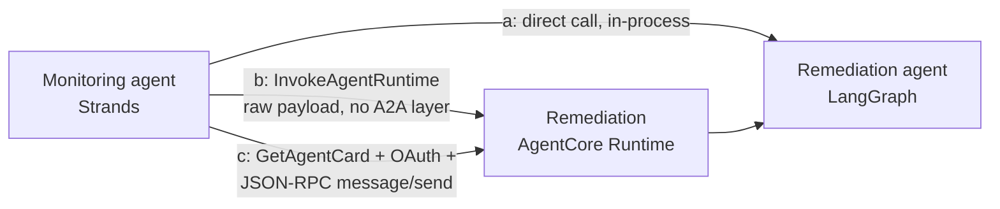

# Two frameworks, two agents, three ways to wire them together

A runnable demo of what the A2A (Agent-to-Agent) protocol actually costs you on Amazon
Bedrock AgentCore, versus the two cheaper alternatives, for a real cross-framework
incident-response pair: a Strands monitoring agent and a LangGraph remediation agent,
each deployed as its own AgentCore Runtime A2A server behind Cognito OAuth.

Built from the real implementation in AWS's own sample,
[`sample-fully-autonomous-incident-response`](https://github.com/aws-samples/sample-fully-autonomous-incident-response)
(`A2A-Multi-Agents-AgentCore-main/multi-agents/`), with three deliberate deviations: two
frameworks instead of three (no Google ADK host orchestrator), LangGraph instead of the
OpenAI Agents SDK for the remediation agent (reusing the framework from the earlier
rajmurugan.com LangGraph-vs-AgentCore post instead of a new OpenAI API key), and a local
static runbook knowledge source instead of JIRA ticketing or Tavily web search. No new
paid third-party API signups.

## Status: deployed, measured, and torn down -- 2026-10-21

The stack deployed for real on 2026-10-21 (Cognito user pool, two ECR images, two
`AWS::BedrockAgentCore::Runtime` A2A servers in `us-east-1`, account `129875820670`), all
three comms patterns ran for real (5 runs each) against the live runtimes, and the
numbers below are copied from `docs/transcript.txt`. Getting there took several
genuinely separate bugs, none of them hypothetical -- see "Sharp edges I hit" below; the
first deploy attempt alone needed four of them fixed before `cdk deploy` produced two
runtimes in `READY` state. The stack was torn down after the transcript was captured
(`make destroy`), and teardown was verified afterwards, not just trusted from the exit
code -- see "Teardown" at the end of this README for exactly what was checked.

## The idea in one diagram

## What it's built to show

| # | Pattern | What it measures |
|---|---------|-------------------|
| a | Direct call | One process, both agents' functions, no AgentCore hop at all |
| b | AgentCore-native invoke | `InvokeAgentRuntime` with a raw JSON payload -- bypasses agent-card discovery and the A2A JSON-RPC envelope |
| c | Full A2A protocol | `GetAgentCard` discovery, a Cognito client-credentials token, then a JSON-RPC 2.0 `message/send` through the same `InvokeAgentRuntime` call |

**A genuine finding, confirmed against the live deploy, not just the botocore model:** the
task behind this repo asked whether AgentCore has a cross-runtime invoke primitive
distinct from A2A. It does -- `InvokeAgentRuntime` -- but it is not a different HTTP
endpoint or transport from the "full A2A" path. Both (b) and (c) go through the identical
data-plane operation against the identical Runtime ARN
(`POST /runtimes/{agentRuntimeArn}/invocations`), and AgentCore genuinely does expose that
as a bare HTTPS endpoint you can `curl` -- confirmed by calling it directly with
`urllib` during this build. The real wrinkle, only visible once a custom JWT authorizer
is actually attached and invoked: **boto3 cannot call it at all.** AWS's own devguide
says so outright ("If you plan on integrating your agent with OAuth, you can't use the
AWS SDK to call InvokeAgentRuntime. Instead, make an HTTPS request") and the first attempt
with boto3 confirmed it. A Runtime supports IAM SigV4 *or* JWT inbound auth, never both,
so once `CustomJwtAuthorizer` is configured -- which it is on both runtimes here, since
testing the A2A protocol requires it -- **every** invocation, not just the "full A2A" one,
needs a raw HTTPS call with an `Authorization: Bearer` header. That collapses the expected
three-tier story even further than the architecture alone suggested: (b) and (c) are the
same transport, the same auth mechanism, and the same payload envelope requirement, once
you account for what the deployed container will actually accept (see below) -- the only
real difference left is whether you fetch the agent card first.

A second finding, only visible by actually sending pattern (b)'s "raw, non-A2A payload" to
a live A2A-protocol runtime: it doesn't reach a different code path in the container, it
reaches the *same* container, and that container -- built as a pure A2A JSON-RPC server,
per AWS's own guidance for how to structure one -- has no other route to send it to. The
raw payload gets a same-shaped JSON-RPC validation error back (not an AgentCore-level
rejection), because AgentCore really is "a transparent proxy layer" all the way down to
payload validation, exactly as its own devguide claims. "Bypassing the A2A envelope" only
bypasses agent-card discovery; it doesn't let you dodge the envelope the container itself
requires.

## Sharp edges I hit

A prior session hit the AWS-SSO-session-expired blocker that used to be documented here;
this session had a fresh login and got all the way to a real deploy, which surfaced sharp
edges that are far more specific to AgentCore itself. In the order they had to be fixed
to get `cdk deploy` past `CREATE_FAILED`:

1. **`NetworkConfiguration` is required, even though the CDK L1 construct's TypeScript
   type marks it optional.** `cdk synth` accepts a `CfnRuntime` with no
   `networkConfiguration`; the service rejects it at deploy time with "Invalid request
   provided: NetworkConfiguration is required". Needed `networkConfiguration: {
   networkMode: 'PUBLIC' }` on both runtimes.
2. **A circular-looking IAM policy, caused by cross-referencing the other Runtime's ARN,
   was actually a dependency-ordering RACE, not a circular dependency.** The cross-runtime
   `InvokeAgentRuntime` grant was originally added via `role.addToPolicy()`, which CDK
   merges into the role's single auto-generated `DefaultPolicy` resource alongside the
   baseline ecr/logs/bedrock permissions the Runtime needs just to be *created*. Because
   that merged policy also referenced the other Runtime's `attrAgentRuntimeArn`,
   CloudFormation created the Policy and the Runtime in parallel (both only depend on the
   Role) -- and the Runtime's own synchronous ECR-access check at creation time routinely
   won that race, failing with "Access denied ... ecr:GetAuthorizationToken" against IAM
   policies that were completely correct, just not attached yet. Fixed by splitting the
   cross-invoke grant into its own `iam.Policy` construct and adding an explicit
   `runtime.node.addDependency(role's DefaultPolicy)` so CloudFormation sequences policy
   attachment before Runtime creation, every time.
3. **`ecr:GetAuthorizationToken` has no resource ARN of its own and isn't covered by
   `repository.grantPull()`** -- that grant only covers the repo-scoped
   `BatchGetImage`/`GetDownloadUrlForLayer`/`BatchCheckLayerAvailability` actions. Needed a
   separate `resources: ['*']` statement for it.
4. **A2A containers must listen on port 9000 at the root path, not port 8080 at
   `/invocations`.** 8080/`/invocations` is the plain-HTTP/MCP protocol convention; AgentCore's
   A2A `ProtocolConfiguration` proxies the container on 9000 at `/` instead, per its own
   devguide. The repo's two Dockerfiles and both agents' `agent.py` originally defaulted to
   8080 (copied from the plain-HTTP convention, not re-checked against the A2A-specific
   docs) -- the runtimes came up `READY` with the wrong port and were simply unreachable.
5. **`boto3` cannot invoke an AgentCore Runtime once a `CustomJwtAuthorizer` is attached** --
   see the finding above. `demo/demo.py`'s original (b)/(c) implementations used
   `boto3.client('bedrock-agentcore').invoke_agent_runtime()`/`get_agent_card()`; both
   needed rewriting to raw `urllib` HTTPS calls with a `Bearer` token.
6. **Cognito's OAuth2 token endpoint lives on the hosted-UI domain, not the issuer URL
   the discovery document advertises.** `demo.py` originally derived the token endpoint by
   string-stripping `/.well-known/openid-configuration` off `DiscoveryUrl` -- that produces
   `https://cognito-idp.<region>.amazonaws.com/<pool-id>`, which doesn't serve
   `/oauth2/token`. Fixed by adding an explicit `CognitoDomainUrl` CDK output from the
   domain construct's own `baseUrl()`.
7. **Claude 3.5 Haiku has reached end-of-life on Bedrock.** The first real model-invoking
   demo run returned `ResourceNotFoundException: This model version has reached the end of
   its life` -- not a hypothetical staleness risk, an actual dead model ID in the code as
   written. Replaced with Haiku 4.5 (`us.anthropic.claude-haiku-4-5-20251001-v1:0`,
   confirmed GA/Active against its AWS model card), which in turn needed an IAM fix: its
   `us-east-1` access is a cross-Region **inference profile**, a different resource type
   from the `foundation-model/*` ARN the original IAM policy granted, so the first
   corrected run still failed with `AccessDeniedException` on
   `bedrock:InvokeModel` until `arn:aws:bedrock:*:*:inference-profile/*` was added
   alongside it.

None of these are "the" sharp edge in the singular the way the SSO blocker was for the
prior session -- they're the actual texture of standing up a brand-new AWS service
(AgentCore Runtime, GA'd 2025) end to end: several real, narrow, individually-googleable
bugs, not one dramatic blocker.

## How it works

- `cdk/` -- CDK (TypeScript) stack: one Cognito user pool with a resource server and two
  client-credentials app clients (one per agent, each scoped only to invoke the *other*
  agent, never itself), two container images built and pushed as CDK assets
  (`DockerImageAsset`, `linux/arm64` -- AgentCore Runtime's required architecture), and
  two `AWS::BedrockAgentCore::Runtime` resources in `ProtocolConfiguration: A2A` mode,
  each behind the shared Cognito discovery URL as a custom JWT authorizer.
- `agents/monitoring_agent/` -- Strands SDK agent with local CloudWatch tools (alarms,
  metrics, log filtering), wrapped by `strands.multiagent.a2a.server.A2AServer` --
  reusing the real pattern from the AWS sample's `monitoring_agent.py`, minus the
  Gateway/Memory/Identity primitives (out of scope here; see below).
  `find_incidents_direct()` is the same logic exposed bare, for comms pattern (a).
- `agents/remediation_agent/` -- LangGraph graph (classify finding -> match a local
  `runbooks.json` entry -> ask the model for a grounded recommendation), wrapped directly
  with the `a2a-sdk`'s `AgentExecutor` / `A2AStarletteApplication` primitives, since
  LangGraph has no built-in A2A server the way Strands does. `remediate_direct()` is the
  same graph exposed bare, for comms pattern (a). `a2a-sdk` is pinned to `0.3.26`
  (`a2a-sdk[http-server]==0.3.26`), not a loose `>=`: the PyPI-default 1.x line removed the
  `A2AStarletteApplication` module this code (and AWS's own sample) is written against.
- `demo/demo.py` -- runs all three comms patterns `RUNS_PER_PATTERN` times each against
  the real deployed stack, prints min/median/max latency per pattern, and prints the cost
  formula (measured call counts x published list-price rates) rather than a precomputed
  number -- see Cost below. Pattern (a) imports both agents' `agent.py` modules
  in-process on the machine running `demo.py`, not inside their containers, so `make
  install` provisions a `.venv` (Python 3.12, matching the Dockerfiles) with both agents'
  full dependency sets -- plain system Python doesn't have strands/langgraph/a2a-sdk
  installed, and several of those packages don't yet support the Homebrew default
  Python 3.14.

## Not in scope

AgentCore Gateway, Memory, Identity (beyond the workload-access-token calls Runtime
makes for you) and Observability primitives from the AWS sample -- this repo only
exercises Runtime + the A2A protocol layer, by design (see the task scope this was built
against). Not a production reference architecture: no VPC isolation, no WAF in front of
the Cognito domain, no secret rotation. Not the AWS sample 1:1 -- no Google ADK host
agent, no JIRA, no Tavily. The `a2a-sdk` wiring in `remediation_agent/agent.py` follows
the library's documented `AgentExecutor` contract and has now been exercised end to end
against a live AgentCore Runtime (see Status) -- agent-card retrieval and `message/send`
both returned real, correct responses.

## Cost

### Measured (from this session's final `make demo` run, 5 runs/pattern)

| Pattern | n | min | median | max |
|---|---|---|---|---|
| (a) direct call | 5 | 2.480s | 2.637s | 4.568s |
| (b) native invoke (raw payload) | 5 | 8.246s | 8.423s | 8.593s |
| (c) full A2A | 5 | 18.699s | 19.116s | 20.970s |

Full raw output: [`docs/transcript.txt`](docs/transcript.txt).

Pattern (b)'s 5 calls never reach the model: as the finding above describes, the
remediation container is a pure A2A JSON-RPC server and rejects pattern (b)'s raw,
non-A2A payload as a validation error before any LangGraph/Bedrock call happens -- its
~8.2-8.6s is pure AgentCore Runtime + Cognito-auth round-trip latency, not model latency,
and its $0 model cost below is real, not a placeholder. Pattern (c)'s extra ~11s over (b)
is the `GetAgentCard`-equivalent discovery GET plus, unlike (b), an actual LangGraph run
(classify -> Bedrock call -> format) that gets far enough to return a real
recommendation.

Pulled from this session's real `AWS/Bedrock` CloudWatch metrics (`InputTokenCount` /
`OutputTokenCount` / `Invocations`, dimensioned by `ModelId`), covering every real model
call made while validating and measuring this stack (one ad hoc validation call, a 5-run
pattern-(a) dry run, and the two full `make demo` runs -- the first with a now-corrected
pricing comment, the second the one in `docs/transcript.txt`; pattern (b)'s calls are not
in this count, since they make zero model calls, see above): **27 invocations, 5,398 input
tokens, 4,215 output tokens**, which at the list rates below is
**$0.0054 + $0.0211 = $0.0265 total**, or roughly $0.001 per model-invoking call. This is
the session aggregate, not isolated to one `make demo` run -- CloudWatch's per-minute
granularity couldn't cleanly separate the two runs' calls from each other once I checked,
and reporting the honest aggregate beats a precise-looking number I couldn't actually
back up. AgentCore Runtime compute itself isn't separately measurable here -- that needs
AgentCore Observability enabled, which is explicitly out of scope for this repo (see "Not
in scope") -- so that part of the bill is list-price-derived only, below.

### List prices (cross-checked 2026-10-20/21, not AWS-account-specific)

- AgentCore Runtime compute: $0.0895/vCPU-hour + $0.00945/GB-hour (v1 tier), billed per
  second with a 1-second minimum and a 128MB memory minimum
  ([pricing](https://aws.amazon.com/bedrock/agentcore/pricing/)). Not independently
  measured this session (see above) -- for 10 real AgentCore invocations each lasting a
  few seconds at the 128MB minimum, this is low-single-digit cents at most, not a material
  share of the total.
- AgentCore Identity: $0.010 per 1,000 token/API-key requests for non-AWS resources; no
  additional charge when used through Runtime, which is the case here.
- Claude Haiku 4.5 on Bedrock, us-east-1, on-demand (via the `us.` cross-Region inference
  profile -- Haiku 4.5 replaced Haiku 3.5 mid-build; see "Sharp edges I hit"): $1.00 per 1M
  input tokens / $5.00 per 1M output tokens. Cross-checked against third-party Bedrock-cost
  aggregators, **not independently confirmed against AWS's own pricing-page table** (it
  renders its price grid client-side and an automated fetch of
  [the Bedrock pricing page](https://aws.amazon.com/bedrock/pricing/) didn't return the
  figure during this build) -- re-verify there before relying on this for a real budget.
- Cognito: free tier covers this demo's token volume; not priced further here.

Total measured + list-price-derived cost for this entire session (deploy, the 27
model-invoking calls above, destroy): well under $0.10, dominated by rounding in
AgentCore Runtime compute's per-second billing, not by model inference.

## Run it

Needs an AWS account with CDK bootstrapped in us-east-1, Node 22+, Python 3.12 specifically
(not whatever `python3` resolves to -- see "How it works" on why `make install` builds its
own `.venv`), Docker (for the `linux/arm64` image builds, and the Docker daemon actually
running, not just installed), and `AWS_PROFILE` set to an identity with permission to
create Cognito, IAM, ECR and `AWS::BedrockAgentCore::*` resources.

    make install   # cdk/ npm install + a python3.12 .venv with both agents' full deps
    make deploy    # Cognito, two ECR images (CDK assets), two AgentCore Runtimes, IAM
    make demo      # runs the three comms patterns, writes docs/transcript.txt
    make destroy   # removes everything

The Cognito client secret never appears in `cdk/cdk.outputs.json`; `make demo` fetches it
live via `DescribeUserPoolClient` so it isn't sitting in a plaintext stack-outputs file.

## Teardown

Verified after `make destroy` on 2026-10-21, not just trusted from its exit code:
`aws cloudformation describe-stacks` for this stack returns `ValidationError: ... does not
exist`, `aws bedrock-agentcore-control list-agent-runtimes` returns an empty list (both
runtimes gone), and `aws cognito-idp list-user-pools` no longer lists this stack's pool
(only pre-existing, unrelated pools from other projects in the same account remain). One
thing `cdk destroy` deliberately does NOT remove: the CDK bootstrap's shared
`cdk-hnb659fds-container-assets-<account>-<region>` ECR repository still holds the image
layers this build pushed (~720MB across 6 images at last check) -- that repo is shared
bootstrap infrastructure used by every CDK app in the account, not something this stack
owns, so deleting it is out of scope for this repo's `make destroy` and wasn't done; its
own lifecycle policy (set by `cdk bootstrap`) will expire old untagged images over time,
and ECR storage at that size is on the order of $0.07/month if left indefinitely --
immaterial next to everything else in this session's bill.
